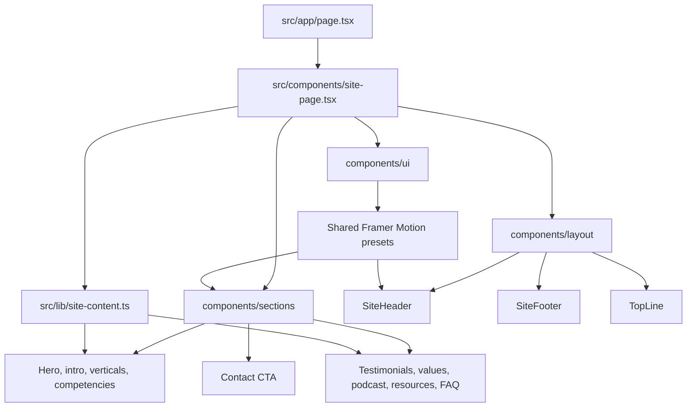
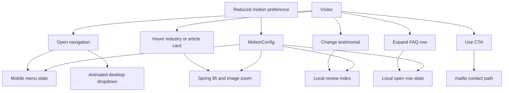
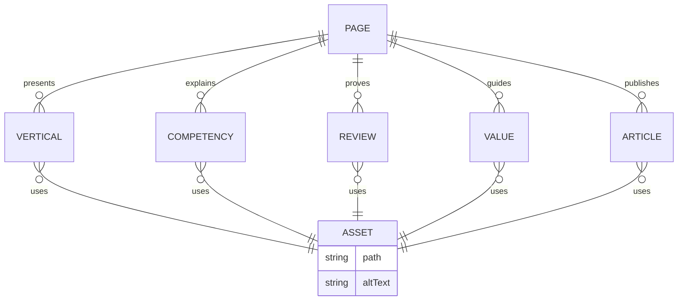
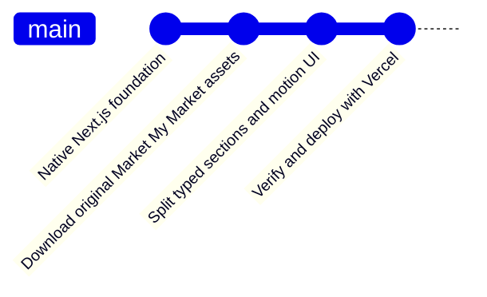
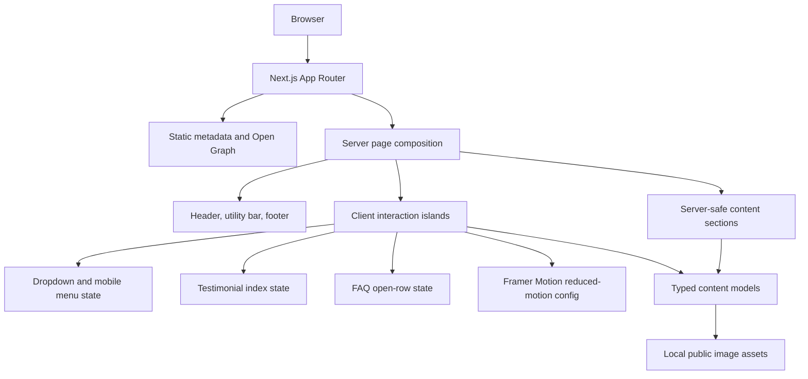
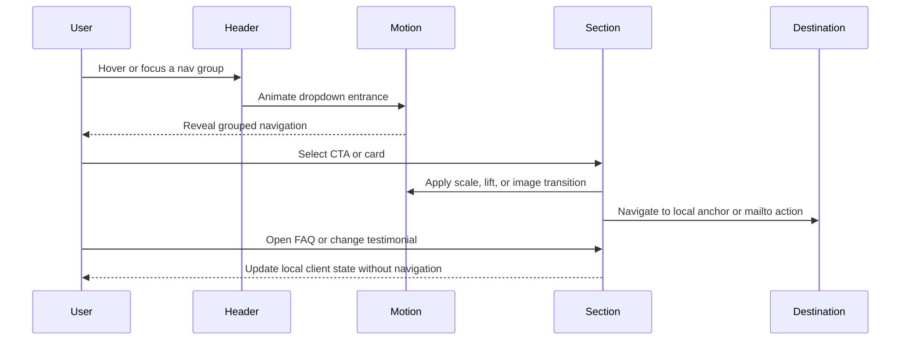
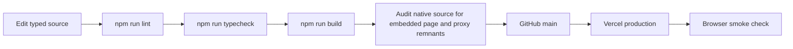

# Market My Market

Native Next.js modernization of the Market My Market homepage. The build preserves the original agency content, palette, typography direction, and downloaded source imagery while adding responsive layout, accessible controls, and restrained Framer Motion interactions.

Live deployment: [marketmymarket.vercel.app](https://marketmymarket.vercel.app/)

Source reference: [marketmymarket.com](https://www.marketmymarket.com/)

## Stack

- Next.js 16 App Router with React 19
- Strict TypeScript
- Framer Motion for navigation dropdowns, cards, CTAs, FAQ, and carousel controls
- Lucide React for interface icons
- Local source imagery stored in `public/images`
- GitHub and Vercel deployment

## Project structure

```text
src/
├── app/
│   ├── globals.css       # Design system and responsive layout
│   ├── icon.png          # Favicon
│   ├── layout.tsx        # Metadata and motion provider
│   └── page.tsx          # Route entry point
├── components/
│   ├── layout/            # Utility bar, header, and footer
│   ├── sections/          # Primary, experience, and conversion sections
│   ├── ui/                # Arrow link and shared motion presets
│   ├── motion.tsx         # Reduced motion provider
│   └── site-page.tsx      # Shallow page composition
└── lib/
    └── site-content.ts    # Typed copy, links, cards, and asset paths
```

## Architecture



## Page flow

```mermaid
flowchart LR
    A[Utility bar] --> B[Sticky navigation]
    B --> C[Driven by what matters]
    C --> D[Agency positioning]
    D --> E[Industry verticals]
    E --> F[Core competencies]
    F --> G[Client proof]
    G --> H[Core values]
    H --> I[Legal Mastermind podcast]
    I --> J[Resources and articles]
    J --> K[FAQ]
    K --> L[Let's talk CTA]
    L --> M[Footer]
```



## Interaction map



## Asset map



The downloaded archive includes the original hero, pattern, vertical, competency, testimonial, value, podcast, logo, and editorial assets. They are referenced locally so the homepage does not depend on a remote source page.

## Scripts

| Command | Purpose |
| --- | --- |
| `npm run dev` | Start the local development server |
| `npm run build` | Create the optimized production build |
| `npm run start` | Serve the production build locally |
| `npm run lint` | Run ESLint checks |
| `npm run typecheck` | Run strict TypeScript checks |

## Local development

```bash
npm install
npm run dev
```

Open [http://localhost:3000](http://localhost:3000).

## Quality checks

```bash
npm run lint
npm run typecheck
npm run build
```

## Deployment flow



The homepage is native Next.js. It does not embed the original page or proxy the original HTML.

## Engineering overview

The design is intentionally split between stable server composition and focused client islands. Only components that need state or motion opt into the client boundary.



## Interaction lifecycle



## Delivery gates



## Architecture decisions

| Decision | Rationale |
| --- | --- |
| Native App Router | Removes the legacy WordPress delivery layer and keeps the page deployable as a real Next.js application |
| Typed content models | Separates editorial updates from layout code and makes repeated cards predictable |
| Client islands | Keeps stateful interactions focused instead of turning the whole page into one client component |
| Framer Motion | Adds tactile feedback to navigation and CTAs without adding a heavy 3D runtime |
| Local assets | Keeps visual parity stable and removes dependence on remote source markup |
| No WebGPU dependency | The page benefits from compositing-friendly transforms, not a 3D scene or shader pipeline |

## Handoff checklist

- Native `src/app` App Router structure
- Organized `layout`, `sections`, `ui`, and `lib` directories
- Local source imagery with descriptive alt text
- Responsive desktop and mobile navigation
- Motion-enabled CTA, dropdown, card, FAQ, and testimonial interactions
- Metadata and Open Graph configuration
- Mermaid documentation for architecture and delivery
- Lint, strict TypeScript, and production build scripts
