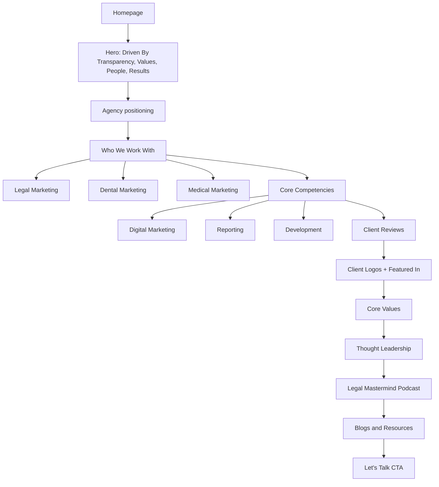
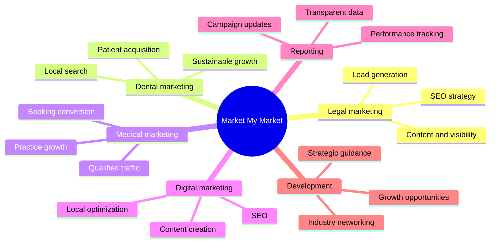
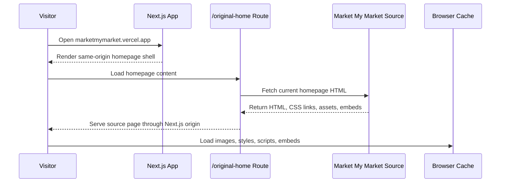
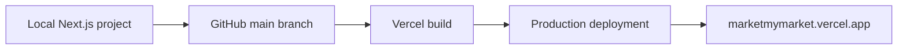

# Market My Market — Homepage Migration

> A Next.js/Vercel migration of the Market My Market homepage, preserving the live site’s content, visual system, imagery, navigation, embeds, and interactions while moving the delivery layer away from WordPress.

Live site: [marketmymarket.vercel.app](https://marketmymarket.vercel.app/)

Source reference: [marketmymarket.com](https://www.marketmymarket.com/)

## What this project preserves

Market My Market positions itself as a transparent, results-driven digital marketing agency serving businesses across competitive verticals. The homepage communicates that through:

- Transparency, values, people, and results as the core promise
- Legal, dental, and medical marketing verticals
- Digital marketing, reporting, and development competencies
- Client testimonials and social proof
- Core values and leadership perspective
- Featured media, client logos, podcast content, and editorial resources
- A direct “Let’s Talk” conversion path

## Homepage architecture



## Service map



## Delivery architecture

The public homepage is delivered from a Next.js shell. The `/original-home` route fetches the live reference page server-side and returns it through the project’s own origin, avoiding the source site’s frame restriction while preserving the rendered page experience. Original visual assets are also stored in `public/images` for the migration archive and future independent component work.



## Asset inventory

The local asset archive includes the extracted homepage imagery and brand materials:

- Site and mobile logos
- Hero and agency imagery
- Legal, dental, and medical marketing imagery
- Core value icons and background patterns
- Client logos and featured-in marks
- Testimonial portraits
- Podcast and editorial graphics
- Favicon assets

Assets live in [`public/images`](./public/images).

## Local development

```bash
npm install
npm run dev
```

Open [http://localhost:3000](http://localhost:3000).

## Production build

```bash
npm run build
npm run start
```

## Deployment

The project is connected to GitHub and Vercel:



## Notes for the next migration phase

The current implementation prioritizes visual parity and fast handoff. The next step toward a fully independent Next.js build would be to replace the source-page proxy with native components while keeping the same section order, content, asset references, and interaction behavior.

